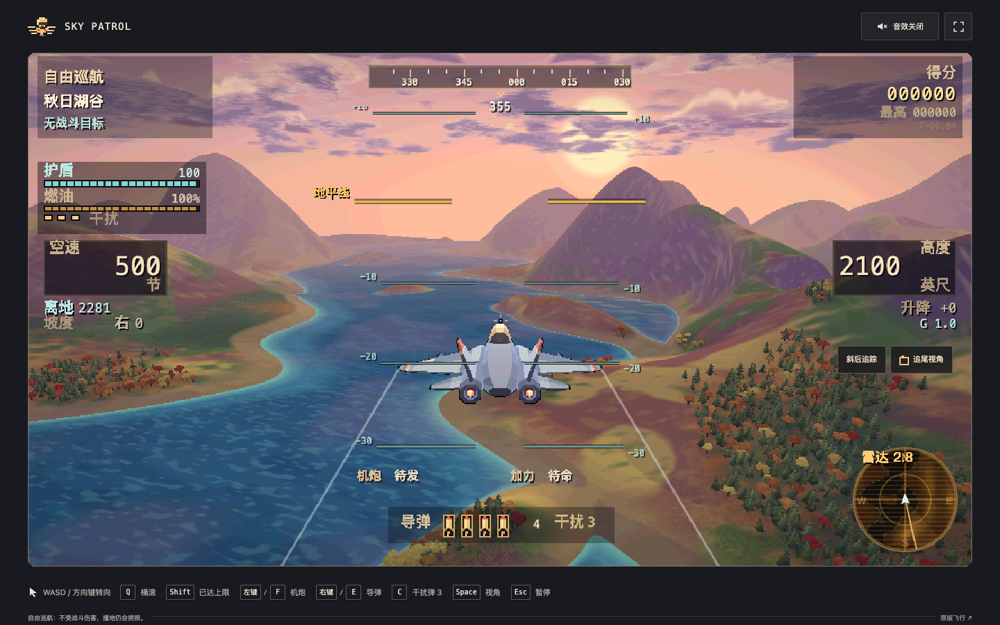
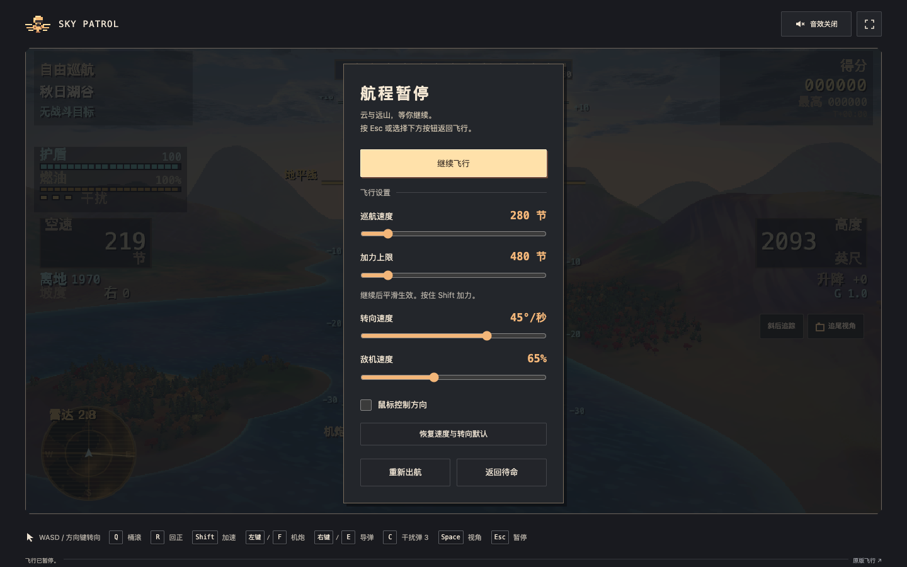
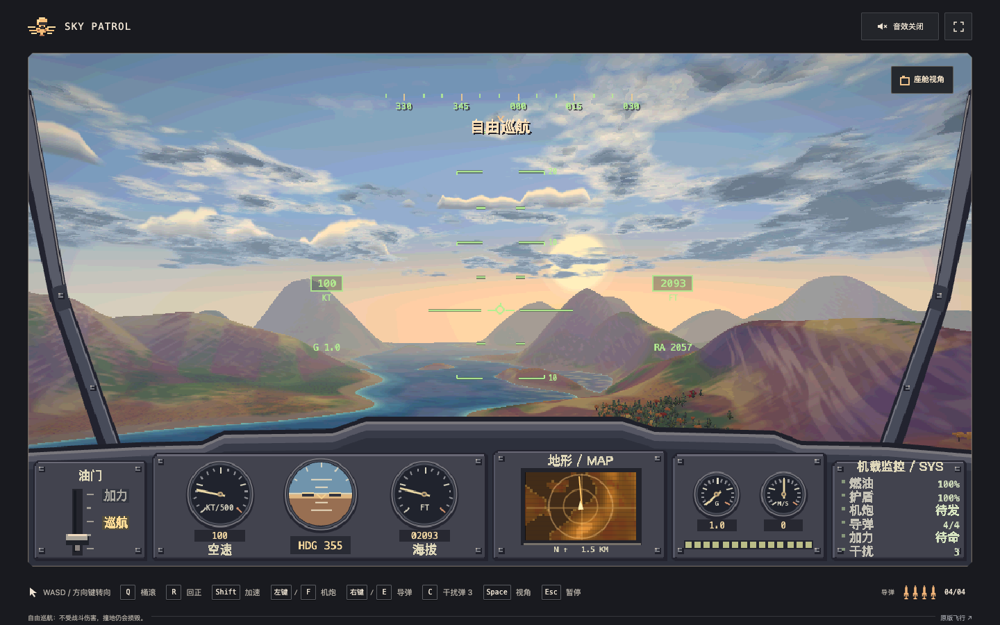

# 天际巡航 · Pixel Sky Patrol

驾驶先进战机守卫秋日湖谷，也可以沿湖自由巡航。原生 JavaScript 与 WebGL2 绘制地形、树林、云层和飞机，配合像素风仪表、三种视角与实体武器弹道。



**主游戏入口：[`sky-patrol/index.html`](sky-patrol/index.html)** · [新版开发说明](sky-patrol/README.md) · [验收记录](sky-patrol/VERIFICATION.md)

## 开始飞行

需要支持 **WebGL2** 的现代浏览器。游戏不需要账号、后端服务或 npm 依赖，已提交可直接运行的 HTML 产物。

```bash
git clone https://github.com/HaoRangQi/pixel-sky-patrol.git
cd pixel-sky-patrol
python3 -m http.server 8765 --bind 127.0.0.1
```

打开 **<http://127.0.0.1:8765/sky-patrol/>**，等待空域准备完成后，选择出航方式：

- **自由巡航**：从南岸沿湖飞行，穿过岛屿和岬角，没有敌军。
- **秋林低飞**：从同一张地图东侧的草谷出发，沿林线飞行。
- **守卫湖谷**：驾驶本方战机拦截入侵编队。点击任务，或按 Enter 起飞。

两种自由飞行模式免受战斗伤害，地形碰撞仍会损毁飞机。也可直接打开 `sky-patrol/index.html`；本地 HTTP 服务便于浏览器加载和运行验收工具。

## 守卫湖谷

1. **无人机入侵**。标准难度拦截 6 架轻型无人机，熟悉视角、锁定和开火。
2. **战斗机入侵**。迎击 8 架火力和机动更强的战斗机。过关后会补给。
3. **空投突袭**。拦住大型运输机和由 10 架敌机组成的混合编队。运输机会释放有限干扰弹诱开来袭导弹，并向干地投下防空装甲车。提前击毁运输机可以阻止后续空投，已经投出的装甲车也要清除。

三关按批次补充敌人，飞机数量多于同时在空中活动的上限，不会一次挤满画面。第 3 关可以先截运输机，也可以先清护航。敌方干扰弹有数量上限，HUD 会显示目标剩余干扰；用导弹消耗完，或直接跟住目标用机炮。清完三关进入结算，选择「继续迎击」可补给后对付空中增援。

### 战斗难度与干扰

主界面或暂停菜单的「设置」里可选 **轻松／标准／挑战**，默认标准；三种敌机的干扰数量和诱骗成功率还能分别微调，改动从下一次出航开始。设置不改变你的武器、护盾或僚机伤害。

| 难度 | 每关空中编制 | 无人机干扰 | 战斗机干扰 | 运输机干扰 | 尾追脱离等待 |
| --- | --- | --- | --- | --- | --- |
| 轻松 | 4／5／6 | 1 发 · 25% | 1 发 · 40% | 2 发 · 55% | 12／9 秒 |
| 标准 | 6／8／10 | 1 发 · 45% | 2 发 · 65% | 3 发 · 75% | 8／6 秒 |
| 挑战 | 8／10／12 | 1 发 · 60% | 2 发 · 75% | 3 发 · 85% | 6／4.8 秒 |

受尾追一段时间后，敌机先显示约 0.9 秒的脱离预兆，再侧向脱离并从前方重新压回攻击，而不是无限直飞送你击杀。机炮可以绕过干扰直接打机身；标准难度下按实际引擎试算，清掉一架敌机通常需要无人机 1–2 发、战斗机 2–3 发、运输机 5–6 发导弹，且每波只有 4 枚导弹，剩下的要靠航炮和战术窗口。

锁定要先把目标带到准星附近：追尾／座舱捕获半径为 38 个逻辑像素，保持范围只多 18%；转出保持圈后发射为无锁弹。目标上的确认环也缩小，避免挡住敌机轮廓。

[第三关实飞画面](shots/sky_defense_stage3_top.png) · [通过三关后的结算](shots/sky_defense_result_portrait.png)

## 带一架辅助僚机

点击主界面出航按钮旁的 **「设置」**，或起飞后按 **Esc**，勾选 **「辅助僚机（本地 AI）」**。起飞前勾选会在下一航次生成；飞行中勾选会立即生成。默认关闭；开启后只有一架友军，围绕你约 180 米伴飞，连续经过前、后、左、右；有敌情时离开去截击，再返回你周围。追尾、俯瞰、座舱和雷达用薄荷色标记区分友军。僚机不会被你锁定，也不会用机炮误伤你。

本地僚机不需要账号、API Key 或网络。它的击杀推进关卡，给予基础分的一半并标记「僚机」，不增加你的个人击杀或连杀。关闭开关会移除当前僚机与友军在途子弹，但本航次的护盾、弹药和补给进度会保留，重新开启不能刷满资源。重新出航和切换模式保留开关，刷新页面恢复关闭。

僚机有 **80 护盾、36 发机炮**，单发伤害 4，普通模式约每 0.42–0.45 秒一发，600 米内才开炮。它会主动选择 1500 米内的敌情、协攻 1800 米内的锁定目标，进入射界攻击一段后拉开再选敌，无人时环绕伴飞；离你超过 2200 米会转回归队。大模型的激进指令也受资源与范围约束。

空弹或护盾降至 20 时，僚机先脱离到约 320 米的外围绕行，**补给 18 秒且至少六秒未受击**后恢复 36 发和 80 护盾；补给期间不开火。敌人的机炮和导弹能击伤它，护盾归零则本航次损毁，下次出航重新归队。操作栏会显示它正在环绕伴飞、截击、脱离还是补给，以及剩余盾量和弹量。

需要大模型辅助判断时，再勾选 **「启用 AI 高层指令」**，填写 OpenAI 兼容的 API 地址（例如 `https://api.example.com/v1`）、模型和 API Key，点击 **「测试连接」**。地址也可填写完整的 `/chat/completions` 路径；本机服务支持 `http://localhost:端口/v1` 或 `http://127.0.0.1:端口/v1`，远程服务使用 HTTPS，并需允许浏览器 CORS 请求。

模型只选择攻击你的目标、掩护、归队或停火，飞行和开火由本地僚机执行。只有开启僚机、启用 AI、配置完整且正在交战时才自动请求，服务商可能按用量收费。连接失败、超时或响应无效时继续使用本地僚机。Key 只留在当前页面的密码框中，不写入本地存储；刷新后 API 地址、模型和 Key 一起清空。

[僚机与 AI 设置面板](shots/sky_wingman_pause_ai_desktop_scrolled.png) · [验收数据](shots/sky_wingman_results.json)

## 操作

鼠标方向控制**默认关闭**，可以在暂停菜单开启；关闭时仍可瞄准、开火。

| 操作 | 键盘／鼠标 | 页面与触屏 |
| --- | --- | --- |
| 左右转向 | A / D 或 ← / → | 画面摇杆 |
| 抬头／俯冲，松开保持俯仰 | W / S 或 ↑ / ↓ | 追尾与座舱的画面摇杆 |
| 加力 | 按住 Shift | 按住「加速」 |
| 机炮 | 按住 F 或鼠标左键 | 按住「机炮」 |
| 导弹 | E 或鼠标右键 | 「导弹」按钮 |
| 干扰弹 | C 或 X | 「C 干扰弹」按钮，显示余量与7秒冷却 |
| 360°桶滚 | Q | 「桶滚」按钮 |
| 180°翻转并保持倒飞 | A 或 D 长按2秒，松开后快速双击同键 | — |
| 平滑恢复水平正飞 | R | 「R 回正」按钮 |
| 追尾 → 座舱 → 俯瞰 | Space | 视角按钮 |
| 正后／斜后追踪（自由飞行） | — | 「斜后追踪／正后追尾」按钮 |
| 暂停／继续 | Esc 或 P | 「暂停／继续飞行」 |
| 音效 | M | 顶部音效按钮 |

**倒飞后按相同步骤可翻回。** 双击需在松开长按后1.2秒内完成，两次按下间隔不超过0.35秒；半滚用1.6秒平滑完成。Q完整桶滚结束后回到原来的正飞或倒飞姿态。

用 **W / S** 把机头对准目标的上下角度，松键后可保持角度再开火。按 **R** 用 1.6 秒平滑恢复水平正飞，倒飞和滚转中途也能回正。

**机炮从机鼻射出，朝准星方向收敛。** 新版追尾与座舱的炮弹和火光共用真实炮口；近处弹点先离开机身，再接近以 900 米为基准的瞄准线，不在准星处凭空生成。平直时间按 900 米和发射世界速度换算，超程后受重力下坠。子弹有飞行时间，移动目标仍需提前量：有效射程内锁定目标时，淡蓝小圆提示应瞄准的相对提前点，不会让已射出的子弹自动转弯。机炮共有 **180 发**，打空后等待 **10 秒**补满；按钮、HUD 和座舱显示实际余量或倒计时，暂停时补给也暂停。

追尾与座舱准星略高于画面中心。白金色亮弹头带着短曳光向前飞，超程后沿真实轨迹下坠；松开后已发射的炮弹继续飞完，不在机身后方堆积静止残线。

淡蓝色与百分比表示正在锁定。等目标变金色并显示「已锁定」，再按 **E** 发射追踪导弹。敌机飞出座舱风挡后，「跟踪」提示会给出相对方位、高低和距离。

触屏在画面上拖动转向，底栏提供战斗操作；短横屏的暂停菜单可上下滚动。辅助技术单次激活加速按钮会短加速1.2秒，持续加力可按住 Shift 或触屏按钮。

## 调整飞行参数

主界面点击 **「设置」** 可提前调整速度、转向、音量、鼠标操纵、僚机和 AI 接入；按 Esc 或「返回主界面」关闭，再选择航程。起飞后仍可按 Esc 调整，继续后平滑生效。设置期间画面和任务时间冻结，调整不会瞬间改变当前空速。

| 参数 | 默认 | 范围与行为 |
| --- | --- | --- |
| 巡航速度 | 300 档，实速 100 节 | 滑块 300–1500。300–500 档的实际空速从 100 节连续增加到 500 节；500 档以上，数值就是实速。HUD 和座舱始终报实际空速 |
| 加力上限 | 500 节 | 两条滑块共用刻度。改巡航时保留选定的加力档差，默认多 200 档，例如巡航从 300 调到 498，加力从 500 跟到 698；手动最少留 50 档。触及 1500 只截断当次数值，调回后恢复原档差 |
| 转向速度 | 30°/秒 · 随速度 | 转向滑块默认不可拖，随巡航设定移动；飞行时按当前实速换算。800 档为 80°/秒，1200 档首次达到 120°/秒。取消「转向随速度自动适配」后可独立设置 8–120°/秒 |
| 敌机速度 | 65% | 巡逻约为你巡航空速的 52–64%、主动交战 62–76%、普通脱离 68–80%。被你从尾后追近时会同向脱离并按距离平滑增速，最高为你当前空速的 95%，让近距点射有连续窗口。敌机转弯半径为你的 1.45–2.2 倍 |
| 战斗难度 | 标准 | 轻松／标准／挑战或自定义；每关编制 4／5／6、6／8／10、8／10／12 架，分别调整三种敌机的干扰数量和诱骗率 |
| 音量 | 55% | 0–100% 滑轨控制主增益：55% 等于原默认听感，100% 是 1.0，0% 静音但不会关掉音效开关；另有顶栏音效开关 |
| 鼠标控制方向 | 关闭 | 开启后鼠标可驾驶；瞄准、开火和触屏操纵独立保留 |

默认起飞时每秒前进约 51 米；按住 Shift 约 0.85 秒达到 500 节，此后每秒前进约 257 米。追尾镜头不靠缩放或改变跟随距离模拟速度。巡航设到 1500 节时没有加力余量，按住 Shift 不耗油。改动在当前页面内保留，重开或换模式仍有效。「恢复速度与转向默认」还原两档速度和自动转向，不改音量和战斗难度。



## 画面与飞行系统

- **稳定追尾**保留机身倾斜，地平线保持水平；**座舱**使用机械仪表、姿态球、绿色平显与真实地形图；**俯瞰**保持北向，机身约占画高十分之一，为周围地景留出空间。屏外敌情箭头显示类型、方向和距离，可在提示位置瞄准锁定。
- 完整HUD显示空速、高度、离地、坡度、升降率、G、燃油、护盾、航向、雷达与武器状态。手机横竖屏分别排布。
- 追尾、座舱和俯瞰使用同一平滑转向节奏。普通转向逐渐倾斜至约 32°，航向变化随暂停菜单中的转向设置调整。
- 机炮曳光弹触地时冒出短火星和浅土尘，落水时溅起小水花。导弹落地有更大的火光和烟柱，落水带起水柱和扩散环。地形可以遮挡射击与锁定。
- 防御无人机和战斗机以可尾追的航向进入湖谷，被追近时不突然掉头冲过玩家；离开追击条件后继续正常交战。新版机炮和导弹在离架时继承载机速度，保留各自相对载机的出膛速度，支持高速尾追射击。
- 两条翼尖尾线在低速平飞时也持续生成，跟随真实翼尖与滚转。低帧率时飞行按墙钟分小步推进，保持实际速度；后台恢复和超过半秒的长停顿采用有界恢复。



## 开发与构建

构建使用 **Node.js 24**，无需安装第三方包。从仓库根目录执行：

```bash
# 生成新版自包含页面
node sky-patrol/build.mjs

# 生成保留的原版入口
node build.mjs
```

修改源码后再构建对应页面，避免只编辑生成的 `index.html`。

```text
sky-patrol/             新版外壳、湖谷场景、飞机、座舱与适配层
  index.html           主游戏产物，自包含HTML
  build.mjs            组合共享引擎与新版模块
src/                   共享世界、渲染、飞行、战斗与原版UI
index.html             原版游戏产物
build.mjs              原版构建入口
tools/                 Node回归、Chrome验收与截图工具
shots/                 游戏画面、录像及验收数据
docs/superpowers/      设计与实现计划
.agents/notes/         行为边界与实现选择
```

后续开发沿用 `feature/reference-pixel-world`。`feature/sky-patrol-ui` 保留初始可玩UI的归档基线，提交为 `37167ae`；根目录的 `index.html` 是继续接收共享修正的原版入口，新版在 `sky-patrol/`，两者分别构建。

## 验证

在本项目验证环境（Node.js 24、macOS、已安装Google Chrome）运行：

```bash
node build.mjs
node sky-patrol/build.mjs
node --test tools/test_*.mjs
git diff --check
```

完整测试包含真实Chrome／WebGL2探针，当前驱动使用 macOS 的 `/Applications/Google Chrome.app/Contents/MacOS/Google Chrome`。其他环境运行浏览器测试前需调整对应驱动路径；游戏页面本身不依赖 macOS。

保持前面的8765端口静态服务运行，再执行实际输入与画面验收：

```bash
node tools/verify_sky_speed.mjs --prefix=sky_tuning_speed
node tools/verify_sky_comfort.mjs
node tools/verify_sky_flare.mjs
node tools/verify_sky_playability.mjs
node tools/verify_sky_feedback.mjs
node tools/verify_sky_occlusion.mjs
```

工具用独立的 Chrome 配置打开正式入口，等待加载后发送键盘、鼠标和触屏输入。俯瞰、R 回正、持角瞄准和落点用仿真步进核对。直飞与加力用浏览器实际运行时间测量。屏幕覆盖 1440×900、390×844、844×390，手机尺寸由 Chrome 模拟。完整数据和截图见 [验收记录](sky-patrol/VERIFICATION.md)。

僚机与 AI 接入验收会自行启动临时静态服务和 OpenAI 兼容模拟接口，无需先启动 8765 服务，也不需要真实 Key：

```bash
node tools/verify_sky_wingman.mjs
```

它覆盖默认关闭、配置与连接、指令执行、失败回退、实际网络取消、重开与刷新、输入焦点及三种尺寸，输出 `shots/sky_wingman_results.json` 和截图。外部服务商的模型兼容性与 CORS 需用其实际配置验证。

## 画面参考

项目参考《Dusk Patrol — Autumn Lake District》的公开试玩和用户提供的画面，采用自己的地形、网格、着色器与界面实现。游戏运行时不使用参考截图作背景，也不加载参考站源码或素材。`shots/` 中带 `reference_` 的图片用于视觉对照，属于文档记录。
