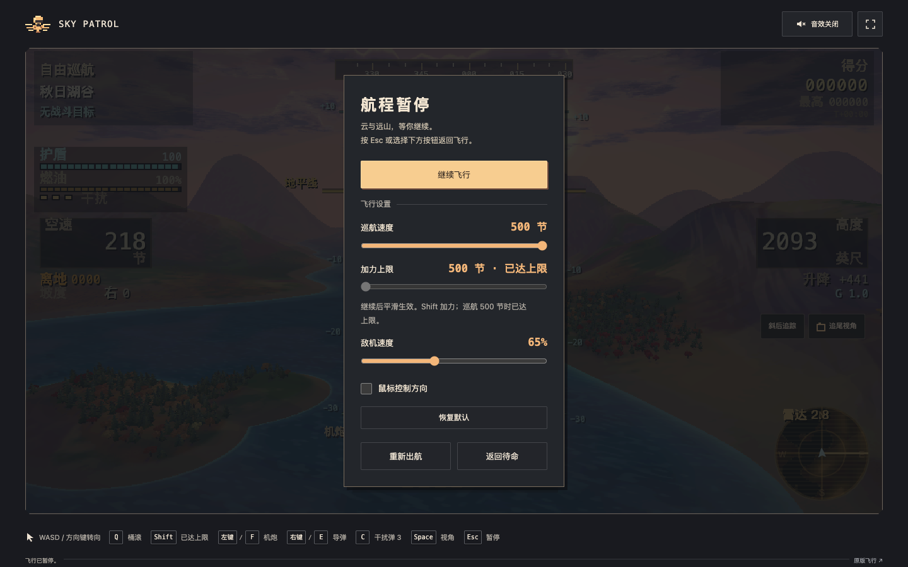
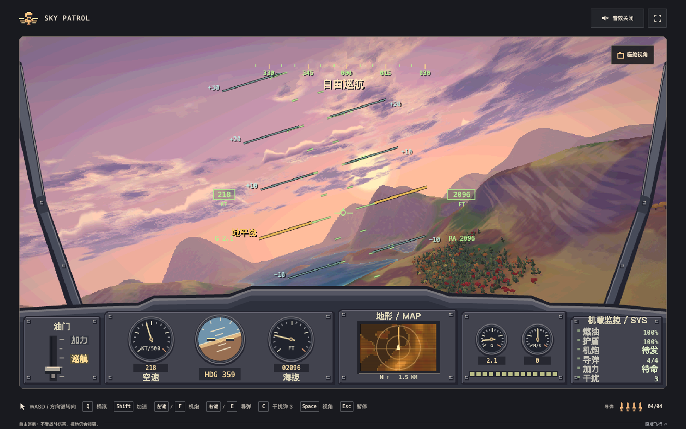

# 天际巡航 · Pixel Sky Patrol

在秋日湖谷中自由飞行，或驾驶战机完成截击任务。原生 JavaScript 与 WebGL2 绘制地形、树林、云层和飞机，配合像素风仪表、三种视角与实体武器弹道。


**主游戏入口：[`sky-patrol/index.html`](sky-patrol/index.html)** · [新版开发说明](sky-patrol/README.md) · [验收记录](sky-patrol/VERIFICATION.md)

## 开始飞行

需要支持 **WebGL2** 的现代浏览器。游戏不需要账号、后端服务或 npm 依赖，已提交可直接运行的 HTML 产物。

```bash
git clone https://github.com/HaoRangQi/pixel-sky-patrol.git
cd pixel-sky-patrol
python3 -m http.server 8765 --bind 127.0.0.1
```

打开 **<http://127.0.0.1:8765/sky-patrol/>**，等待空域准备完成后，选择出航方式：

- **自由巡航**：从南岸沿湖飞行，穿过岛屿和岬角，没有敌军。
- **秋林低飞**：从同一张地图东侧的草谷出发，沿林线飞行。
- **截击任务**：击落敌机、推进波次，注意地形与来袭导弹。

两种自由飞行模式免受战斗伤害，地形碰撞仍会损毁飞机。也可直接打开 `sky-patrol/index.html`；本地 HTTP 服务便于浏览器加载和运行验收工具。

## 操作

鼠标方向控制**默认关闭**，可以在暂停菜单开启；关闭时仍可瞄准、开火。

| 操作 | 键盘／鼠标 | 页面与触屏 |
| --- | --- | --- |
| 左右转向、抬头／俯冲 | WASD 或方向键 | 画面摇杆 |
| 加力 | 按住 Shift | 按住「加速」 |
| 机炮 | 按住 F 或鼠标左键 | 按住「机炮」 |
| 导弹 | E 或鼠标右键 | 「导弹」按钮 |
| 干扰弹 | C 或 X | 「C 干扰弹」按钮，显示余量与7秒冷却 |
| 360°桶滚 | Q | 「桶滚」按钮 |
| 180°翻转并保持倒飞 | A 或 D 长按2秒，松开后快速双击同键 | — |
| 追尾 → 座舱 → 俯瞰 | Space | 视角按钮 |
| 正后／斜后追踪（自由飞行） | — | 「斜后追踪／正后追尾」按钮 |
| 暂停／继续 | Esc 或 P | 「暂停／继续飞行」 |
| 音效 | M | 顶部音效按钮 |

**倒飞后按相同步骤可翻回。** 双击需在松开长按后1.2秒内完成，两次按下间隔不超过0.35秒；半滚用1.6秒平滑完成。Q完整桶滚结束后回到原来的正飞或倒飞姿态。

触屏在画面上拖动转向，底栏提供战斗操作；短横屏的暂停菜单可上下滚动。辅助技术单次激活加速按钮会短加速1.2秒，持续加力可按住 Shift 或触屏按钮。

## 暂停时调整飞行参数

起飞后按 Esc。调整不会推进游戏或瞬间改变当前空速，继续后平滑生效。

| 参数 | 默认 | 范围与行为 |
| --- | --- | --- |
| 巡航速度 | 约218节（精确112 m/s） | 100–500节；约两秒完成大部分速度变化 |
| 加力上限 | 500节 | 最高500节；通常保留至少50节加力余量，接近上限时封顶 |
| 敌机速度 | 65% | 原速度的30–120%；现有敌机平滑变速，新出生敌机直接采用倍率 |
| 鼠标控制方向 | 关闭 | 开启后鼠标可驾驶；瞄准、开火和触屏操纵独立保留 |

巡航设为500节时已达到总上限，Shift不再空耗加力燃油。设置在当前页面内保留，重开或换模式仍有效，刷新页面恢复默认。「恢复默认」按钮还原巡航和加力速度。

实飞对照：相同航线飞4秒，100／500节分别前进约206／1029米；默认巡航按住Shift三秒可达到500节，前进约603米，未加速时约336米。差异来自实际位移，追尾视野不随加速伸缩。



## 画面与飞行系统

- **稳定追尾**保留机身倾斜，地平线保持水平；**座舱**使用机械仪表、姿态球、绿色平显与真实地形图；**俯瞰**跟随真实飞机，显示北向近景。
- 完整HUD显示空速、高度、离地、坡度、升降率、G、燃油、护盾、航向、雷达与武器状态。手机横竖屏分别排布。
- 普通座舱转向逐渐进入约32°倾斜，航向变化约22°/秒；倒飞切换视角也保持连续过渡。
- 机炮使用有飞行时间和重力的实体曳光弹；导弹从挂架离开后制导，无锁时沿前方长弧下落，尾烟留在经过的世界位置。地形可以遮挡射击与锁定。



## 开发与构建

构建使用 **Node.js 24**，无需安装第三方包。从仓库根目录执行：

```bash
# 生成新版自包含页面
node sky-patrol/build.mjs

# 生成保留的原版入口
node build.mjs
```

修改源码后再构建对应页面，避免只编辑生成的 `index.html`。

```text
sky-patrol/             新版外壳、湖谷场景、飞机、座舱与适配层
  index.html           主游戏产物，自包含HTML
  build.mjs            组合共享引擎与新版模块
src/                   共享世界、渲染、飞行、战斗与原版UI
index.html             原版游戏产物
build.mjs              原版构建入口
tools/                 Node回归、Chrome验收与截图工具
shots/                 游戏画面、录像及验收数据
docs/superpowers/      设计与实现计划
.agents/notes/         行为边界与实现选择
```

`main` 是主开发分支。`feature/sky-patrol-ui` 保留初始可玩UI的归档基线，提交为 `37167ae`；主分支根目录的 `index.html` 是继续接收共享修正的原版入口，新版在 `sky-patrol/`，两者分别构建。

## 验证

在本项目验证环境（Node.js 24、macOS、已安装Google Chrome）运行：

```bash
node build.mjs
node sky-patrol/build.mjs
node --test tools/test_*.mjs
git diff --check
```

完整测试包含真实Chrome／WebGL2探针，当前驱动使用 macOS 的 `/Applications/Google Chrome.app/Contents/MacOS/Google Chrome`。其他环境运行浏览器测试前需调整对应驱动路径；游戏页面本身不依赖 macOS。

保持前面的8765端口静态服务运行，再执行实际输入与画面验收：

```bash
node tools/verify_sky_speed.mjs --prefix=sky_comfort_speed
node tools/verify_sky_comfort.mjs
node tools/verify_sky_flare.mjs
```

工具使用独立无头Chrome配置，等待真实加载完成后，通过鼠标、触屏和键盘输入操作正式入口；数值检查使用游戏的仿真步进接口。最新记录为 **182项回归通过**、**9项舒适度浏览器检查通过**，并覆盖1440×900、390×844、844×390。完整范围、截图和历史结果见 [VERIFICATION.md](sky-patrol/VERIFICATION.md)。手机验证来自Chrome设备模拟，真机、Safari与长期性能尚未验证。

## 画面参考

项目参考《Dusk Patrol — Autumn Lake District》的公开试玩和用户提供的画面，采用自己的地形、网格、着色器与界面实现。游戏运行时不使用参考截图作背景，也不加载参考站源码或素材。`shots/` 中带 `reference_` 的图片用于视觉对照，属于文档记录。
